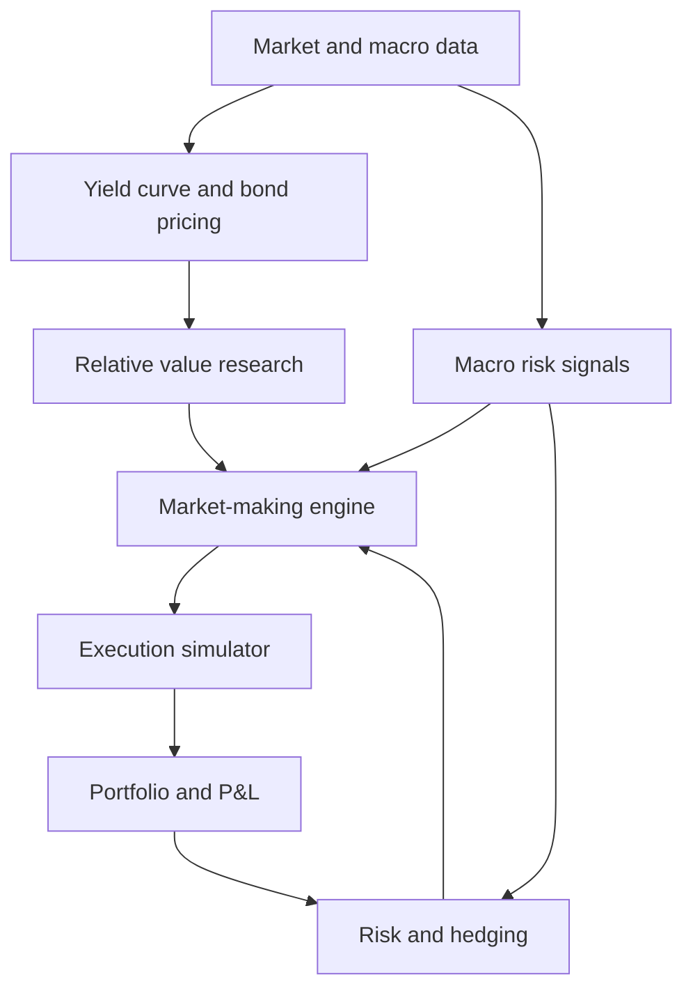

# yieldcurve-relativevalue-trader
Developing a Python-based fixed income trading system focused on yield curve modelling, relative value research, market making and risk management. Copy
# Yield Curve Relative Value Trader

**A fixed-income research and market-making simulator built in Python.**

This project explores how government bonds are priced, how relative-value opportunities can be identified from yield curves, and how a trading system can turn those estimates into quotes while managing inventory and interest-rate risk.

The project is being developed in stages, starting with the financial mathematics and ending with a **macro-aware fixed-income market-making simulator**. The immediate focus is on learning, rigorous modelling, and reproducible experimentation, not live trading or claims of profitability.

> **Project status:** In planning and foundational learning. The features below describe the intended roadmap, not completed functionality.

## Objectives

- **Price bonds:** Value government bonds from their cash flows and appropriate discount curves.
- **Model yield curves:** Understand spot, par, and forward rates; construct and fit term structures.
- **Study relative value:** Compare observed bond prices/yields with model-implied values and test whether deviations contain useful information.
- **Make markets:** Simulate two-sided quotes based on fair value, volatility, liquidity, and inventory.
- **Manage risk:** Measure DV01, convexity, concentration, and P&L; hedge or reduce exposures when needed.
- **Incorporate macro information:** Explore how interest-rate expectations, central bank events, and changing volatility affect pricing and quoting decisions.

## Project architecture (planned)



The relative-value model provides inputs to the trading engine. The market maker must still decide **where to quote, how much to quote, and how much risk to retain**. A model-implied discount is not automatically a tradable opportunity.

## Roadmap

### Phase 0: Financial mathematics and market foundations

**Goal:** Understand the instruments and risk measures before automating trading decisions.

- [ ] Bond cash flows, coupon conventions, maturity, and accrued interest
- [ ] Clean versus dirty prices; price-yield relationship and yield to maturity
- [ ] Discount factors, zero/spot rates, par rates, forward rates, and curve bootstrapping
- [ ] Macaulay and modified duration, convexity, and DV01
- [ ] Parallel and non-parallel yield curve shifts; basic steepener/flattener positions
- [ ] Carry, roll-down, mark-to-market P&L, and transaction costs
- [ ] Solve practice problems and independently reproduce calculations in Python

**Completion criteria:** Explain and compute a fixed-coupon bond's price, yield, duration, convexity, and DV01; distinguish a par yield curve from a zero-coupon discount curve.

**Learning resources:**

- [MIT 15.401: Fixed-Income Securities (Parts I–III)](https://ocw.mit.edu/courses/15-401-finance-theory-i-fall-2008/pages/video-lectures-and-slides/fixed-income-securities/)
- [MIT 15.401: Fixed-Income Recitation](https://ocw.mit.edu/courses/15-401-finance-theory-i-fall-2008/resources/mit15_401f08_rec02/)
- [MIT 15.401: Problem Sets (Fixed Income Problem Set 2)](https://ocw.mit.edu/courses/15-401-finance-theory-i-fall-2008/pages/problem-sets/)
- [MIT 18.642: Bond Mathematics](https://ocw.mit.edu/courses/18-642-topics-in-mathematics-with-applications-in-finance-fall-2024/pages/week-1/)

### Phase 1: Bond pricing and yield curve modelling

**Goal:** Build and validate a reusable pricing foundation.

- [ ] Implement fixed-coupon and zero-coupon bond cash-flow schedules
- [ ] Implement present-value pricing and yield-to-maturity calculations
- [ ] Calculate accrued interest, clean price, and dirty price
- [ ] Construct a simple zero-coupon discount curve from toy market inputs
- [ ] Explore interpolation and a smooth curve fit (for example, Nelson–Siegel)
- [ ] Implement duration, convexity, DV01, and repricing under rate shocks
- [ ] Download and clean historical government yield curve data
- [ ] Add unit tests against hand calculations and finite-difference sensitivity checks

**Deliverable:** A tested Python bond pricer and yield curve module, with example plots and a short methods note.

**Completion criteria:** A bond's cash flows can be valued consistently with a specified discount curve, and calculated risk measures agree with small-shock repricing within stated tolerances.

### Phase 2: Relative-value research and backtesting

**Goal:** Investigate whether bond pricing deviations provide useful trading information.

- [ ] Define a restricted universe of government bonds and maturities
- [ ] Fit or calibrate a reference curve using information available at each timestamp
- [ ] Compare observed bond prices/yields with model-implied values
- [ ] Analyse curve residuals, yield spreads, mean reversion, and possible regime changes
- [ ] Develop simple, interpretable candidate signals and benchmark strategies
- [ ] Construct approximately DV01-neutral relative-value positions
- [ ] Model price changes, carry, roll-down, funding, and transaction costs
- [ ] Use chronological train/test splits and walk-forward evaluation
- [ ] Report returns, drawdowns, turnover, exposures, and failure cases

**Deliverable:** A reproducible research notebook and backtest report evaluating at least one clearly stated hypothesis.

**Completion criteria:** Every signal has an economic rationale, a transparent P&L calculation, and out-of-sample results. Unprofitable or inconclusive findings are recorded honestly.

### Phase 3: Market-making and execution simulator

**Goal:** Convert pricing estimates into a simulated two-sided quoting strategy.

- [ ] Build a baseline fair-value-centred bid/ask quoting model
- [ ] Adjust spreads for volatility, estimated execution costs, and market conditions
- [ ] Simulate order arrivals, fill probabilities, and adverse selection
- [ ] Track fills, trade inventory, cash, and marked-to-market P&L
- [ ] Compare fixed spreads against adaptive quoting rules
- [ ] Evaluate spread capture separately from inventory gains/losses
- [ ] Test behaviour under sudden price moves and low-liquidity scenarios

**Deliverable:** An event-driven market-making simulator with an auditable trade log and performance summary.

**Completion criteria:** The system can generate quotes, process simulated fills, and reconcile positions and P&L. Fill-model assumptions are explicit and stress-tested.

### Phase 4: Inventory, hedging, and risk management

**Goal:** Control the risks introduced by providing liquidity.

- [ ] Skew bid/ask prices and sizes based on current inventory
- [ ] Define position, DV01, drawdown, and concentration limits
- [ ] Add configurable stop-quoting and risk-reduction conditions
- [ ] Simulate hedging with a related bond or government-bond futures exposure
- [ ] Track residual curve risk and potential hedge mismatch
- [ ] Attribute P&L to spread capture, price moves, carry, hedges, and costs
- [ ] Stress-test parallel and non-parallel yield curve shocks

**Deliverable:** A risk-aware market maker that can adapt or suspend quotes and explain its current exposures.

**Completion criteria:** Risk limits are enforced in tests, hedging logic is measurable, and trading results include risk-adjusted comparisons with the unhedged baseline.

### Phase 5: Global macro integration

**Goal:** Test whether macroeconomic information improves pricing or risk decisions.

- [ ] Integrate historical policy rates, yield curve movements, and selected macro releases
- [ ] Preserve actual publication timestamps to prevent look-ahead bias
- [ ] Define interpretable macro regimes or event-risk indicators
- [ ] Adjust spreads, quote sizes, or risk limits in response to changing conditions
- [ ] Compare macro-aware quoting with the same simulator without macro inputs
- [ ] Analyse performance around central bank decisions and yield shocks

**Deliverable:** A macro-aware quoting/risk overlay and an ablation study showing what, if anything, it improves.

**Completion criteria:** The macro component adds measurable value under a consistent evaluation procedure, or the project documents why it does not.

### Phase 6: Reproducibility, interface, and optional paper trading

**Goal:** Make the research and simulator easy to inspect, reproduce, and demonstrate.

- [ ] Refactor research code into documented modules
- [ ] Provide configuration files and repeatable experiment commands
- [ ] Add automated tests and continuous integration
- [ ] Build a simple dashboard for yield curves, quotes, positions, and P&L
- [ ] Publish assumptions, limitations, data provenance, and results
- [ ] **Optional:** Explore paper trading with suitable executable market data and a supported broker API

**Deliverable:** A reproducible repository, demonstration, and technical summary suitable for a portfolio or interview discussion.

## Suggested technology stack

| Purpose | Planned tools |
| --- | --- |
| Core development | Python, NumPy, pandas, SciPy |
| Statistics and curve fitting | statsmodels, scikit-learn, SciPy |
| Pricing cross-checks (later) | QuantLib |
| Charts and dashboard | Matplotlib or Plotly, optionally Streamlit |
| Testing | pytest |
| Data storage | CSV/Parquet initially; SQLite if needed |
| Version control | Git and GitHub |

Simple, well-tested implementations are preferred over adding libraries before they are needed.

## Initial data sources

- [European Central Bank: Euro-area yield curves](https://data.ecb.europa.eu/methodology/yield-curves)
- [U.S. Treasury: Interest rate statistics](https://home.treasury.gov/policy-issues/financing-the-government/interest-rate-statistics)
- [ECB Data Portal API documentation](https://data.ecb.europa.eu/help/api/data)

**Data caveat:** A daily par-yield series is not the same as a zero-coupon discount curve or an executable bond quote. The research stage will need appropriately defined pricing inputs and, where possible, observed individual bond prices. Public daily yield curves alone are **not** sufficient to validate intraday market-making fills or realized bid/ask profits. Early execution results will therefore be clearly labelled as *simulation*.

## Evaluation principles

1. **Financial correctness:** Validate conventions, cash flows, pricing, and risk sensitivities.
2. **No look-ahead bias:** Only use information available at each simulated decision time.
3. **Realistic assumptions:** State execution, liquidity, transaction-cost, and funding assumptions explicitly.
4. **Baselines first:** Compare more complex models against simple, interpretable rules.
5. **Risk before returns:** Measure inventory, DV01, drawdowns, and stress losses alongside P&L.
6. **Reproducibility:** Keep experiments configurable, logged, and testable.

## Planned repository structure

The following is a **proposed structure**, not a claim that these directories already exist:

```text
yield-curve-relative-value-trader/
├── README.md
├── data/                 # Local or sample datasets (with licensing checks)
├── notebooks/            # Research and exploratory analysis
├── src/
│   ├── data/             # Data loading and validation
│   ├── pricing/          # Bond cash flows, discounting, curves
│   ├── research/         # Relative-value signals and backtests
│   ├── market_making/    # Quotes, fills, inventory decisions
│   ├── risk/             # DV01, limits, hedging, P&L
│   └── macro/            # Macro indicators and regime analysis
├── tests/                # Unit and integration tests
└── reports/              # Figures and experiment summaries
```

## Current next steps

- [ ] Complete MIT 15.401 Fixed-Income Securities Parts I–III
- [ ] Solve MIT Fixed Income Problem Set 2
- [ ] Implement a basic fixed-coupon bond pricer in Python
- [ ] Check price-yield sensitivity numerically and graphically
- [ ] Start Phase 1 yield curve construction

---

*This is an educational research and simulation project. No live trading or investment performance is implied.*
